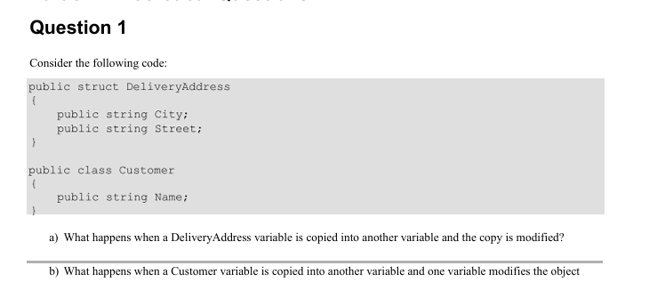
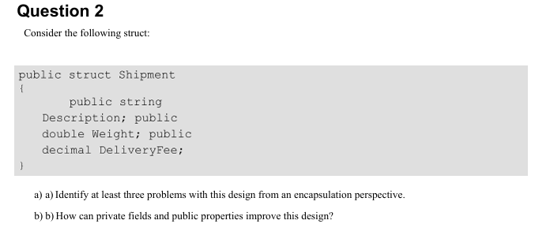

# Theoretical Questions & Answers

### Q1: a)  What happens when a DeliveryAddress variable is copied into another variable and the copy is modified? 
* **Answer:** The value of the variable whose copy was modified changes, while the variable that wasn't changed remains the same because the struct is a value type, not a reference type.

### Q1: b) What happens when a client variable is copied to another variable and one of the variables modifies the object?
* **Answer:** The change happens in both variables because a class is a reference type, not a value type, so both variables point to the same address of the class in the heap.

---

### Q2: a) Identify at least three problems with this design from an encapsulation perspective?
* **Answer:** 
 1. Anyone can modify the code with any value, even if it's incorrect.
 2. To prevent anyone from changing the variables, I’d have to make them private so no one can access them.
 3. The set and get methods have to be at the same level, public or private; I can't separate them, so I can't make one ReadOnly.

### Q2: b) How can private fields and public properties improve this design? 
* **Answer:** 
1. I can do validation
2. I can make properties ReadOnly
